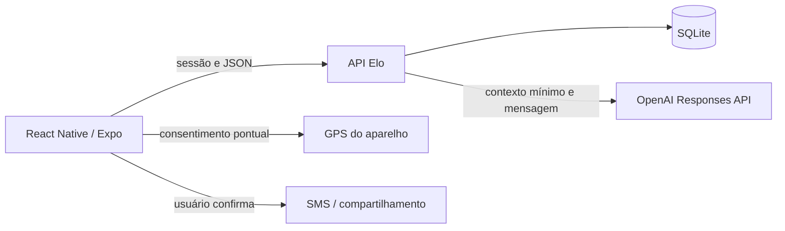

# Arquitetura

O cliente React Native usa componentes TypeScript e módulos Expo para foto, localização, voz, SMS e armazenamento seguro. App.tsx organiza autenticação e abas; os componentes em src/ concentram cada fluxo. A prévia web serve para desenvolvimento e testes de interface.

O servidor Node.js 24 expõe HTTP/JSON e persiste em SQLite. Tokens de sessão são armazenados como hash; senhas usam scrypt com salt. Rotas de conversa exigem match recíproco e ausência de bloqueio. Rotas de segurança só acessam dados do usuário autenticado. As contas fictícias são identificadas e não aceitam login.

server/safety-ai.mjs limita o papel do assistente, solicita JSON estruturado e rejeita algumas afirmações indevidas de envio. Isso reduz erros, mas não garante acerto do modelo. server/safety.mjs persiste contatos, consentimento, conversa e estado dos pedidos; evita chamadas simultâneas e limita consumo por sessão de usuário. O envio de SMS é do sistema operacional, sem alegação de confirmação de entrega.

server/.env guarda a chave apenas no backend e está ignorado pelo Git. Logs não incluem prompts nem chave. O chat e os pedidos ficam no banco local; a conversa pode ser apagada pela interface. Coordenadas e telefone do contato não são incluídos no contexto de IA. O texto digitado pelo usuário é enviado como ele o escreveu; ele pode conter dados pessoais.

O catálogo e as opções dos filtros são compartilhados entre cliente e servidor. Retratos adicionais usam imagens com quatro células e recorte no componente ProfileImage, preservando a fotografia inteira de cada personagem.

## Escopo acadêmico

SQLite e scrypt síncronos são adequados para esta demonstração pequena; escala maior exige medir contenção, mover trabalho de senha para processamento assíncrono e revisar armazenamento. HTTP local, conta demo e assinatura Android de desenvolvimento não constituem uma configuração de loja ou produção. Falta hospedagem pública, processo de moderação, recuperação de conta e operação de um serviço de alerta. A interface não promete essas capacidades.

## Assistente 0.2.0

O retorno estruturado contém reply, category e actions. A lista de ações é fechada em shared/assistant-actions.json. Uma ação proposta não é executada pelo modelo: o usuário confirma um modal, o servidor valida propriedade da mensagem e pertença da ação à proposta, e o cliente chama uma função do aparelho. safety_actions registra estados informados pelo cliente; não comprova entrega ou ligação.

O contexto de perfil exige profileConsent e rejeita perfis bloqueados ou incompletos. Inclui somente nome, idade, cidade, bio, interesses e intenção. Não inclui fotografia nem mensagens privadas do match. A análise resume fatos declarados e sugere perguntas; não determina caráter ou segurança.
